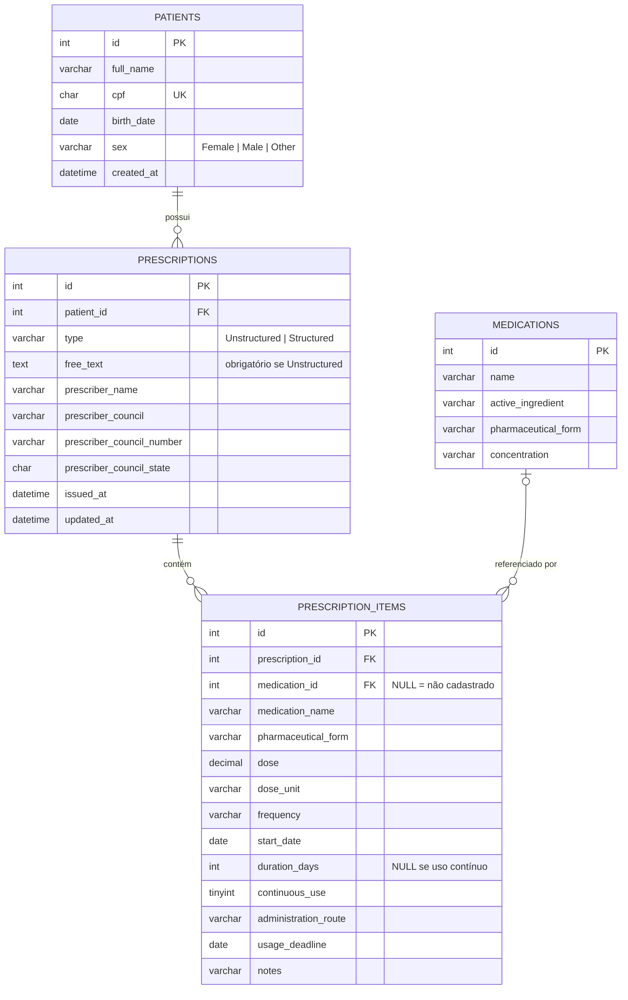

# DER – Prescrição Médica

## Relacionamentos e integridade

| Relação | Cardinalidade | FK / Ação |
|---|---|---|
| Paciente → Prescrição | 1 : N | `prescriptions.patient_id` → `patients.id` (`ON DELETE RESTRICT`) |
| Prescrição → Item | 1 : N | `prescription_items.prescription_id` → `prescriptions.id` (`ON DELETE CASCADE`) |
| Medicamento → Item | 0..1 : N | `prescription_items.medication_id` → `medications.id` (`ON DELETE RESTRICT`, coluna anulável) |

Restrições `CHECK` no banco reforçam as regras de negócio:

- `ck_prescriptions_free_text`: receita `Unstructured` exige `free_text`; `Structured` não tem `free_text`.
- `ck_prescription_items_dose`: `dose > 0`.
- `ck_prescription_items_duration`: uso contínuo ⇒ sem duração; senão, duração entre 1 e 365 dias.
- `ck_prescription_items_deadline`: prazo de utilização ≥ início do tratamento.

Scripts: [`init/01-schema.sql`](init/01-schema.sql) (estrutura) e [`init/02-seed.sql`](init/02-seed.sql) (pacientes, medicamentos e prescrições de exemplo).
